# Clawd Pulse

A live dashboard pane for Claude Code: your running sessions, your **5-hour** and **weekly** usage limits, and Clawd, whose mood follows them.

<p>
  
  
</p>
<p>
  
  
</p>

| Clawd is… | when |
| --- | --- |
| 😊 **Happy**: bouncing, blinking | plenty of usage left, nothing running |
| ⚙️ **Working**: typing, sparkles | at least one session is busy |
| 😓 **Tired**: droopy eyes, sweat drop | a limit is 80% used or more |
| 😴 **Sleeping**: floating z's | a limit is 95% used or more |

A cable from Clawd's arm feeds the two ring gauges. Energy flows fast while working, slows when tired and stops when asleep. Below the gauges is a list of your sessions, with running ones on top.

## Install

You need Claude Code **2.1.295 or newer**. Check with `claude --version`, and run `claude update` if yours is older.

From any terminal:

```bash
claude plugin marketplace add RicciRicch/clawd-pulse
claude plugin install clawd-pulse@clawd-mods
```

Or, inside an interactive `claude` session in a terminal, type:

```
/plugin install clawd-pulse --marketplace RicciRicch/clawd-pulse
```

Answer `y` to add the marketplace, then pick a scope (user scope loads it in every session).

The dashboard opens by itself when a session starts. Reopen it any time with **`/pulse`**.

## Where it works

- **Claude desktop app (Code tab):** the full dashboard. Clawd is animated, and you get the gauges and the list of all your sessions.
- **Terminal:** a text version. Clawd appears as the block-letter logo and the limits as bars. The list of *other* sessions comes from the desktop app, so a terminal shows only the current one.

Limits appear on Claude subscription plans (Pro, Max, Team). With an API key there are no plan limits to show.

## Does it cost tokens?

No. The mod never calls the model and adds nothing to Claude's prompt. It reads figures Claude Code already has (the session list and plan usage) and refreshes them every 30 seconds on your machine. Running `/pulse` adds one short line to the conversation, and that's the only cost.

## Uninstall

```bash
claude plugin uninstall clawd-pulse@clawd-mods
```

## Develop

```
.claude-plugin/plugin.json       manifest
.claude-plugin/marketplace.json  makes this repo installable
hooks/register.tsx               the mod: data, mascot SVG, pane
hooks/register.test.ts           tests (desktop + terminal)
types/index.d.ts                 the mod's state contract
```

```bash
claude plugin validate .
claude plugin test .
```

---

An unofficial fan project, not affiliated with or endorsed by Anthropic. "Claude" and Clawd belong to Anthropic. MIT licensed.
